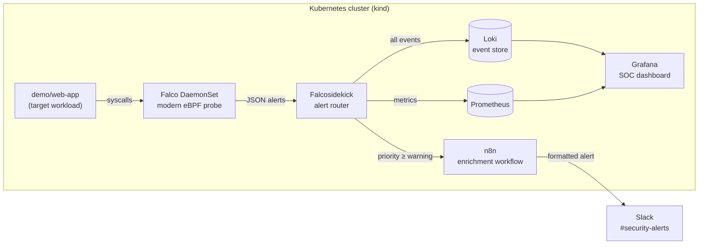

# 🛡️ Kubernetes Security Monitoring Lab

A lightweight, open-source **runtime security monitoring and intrusion detection** stack for Kubernetes: Falco detects suspicious behaviour inside containers, events are stored in Loki and visualised in a Grafana **SOC dashboard**, and important alerts are routed through **n8n** to **Slack**.

> Built as a hands-on lab to explore cloud-native security monitoring (SIEM-lite) on Kubernetes.


---

## 🏗️ Architecture



| Layer | Tool | Role |
|---|---|---|
| Detection | **Falco** (modern eBPF) | Watches kernel syscalls of every container and matches them against rules |
| Detection-as-code | `falco-rules/custom-rules.yaml` | Custom rules mapped to MITRE ATT&CK tactics |
| Routing | **Falcosidekick** | Fans alerts out to several outputs with per-output priority thresholds |
| Storage | **Loki** | Indexes security events by labels (rule, priority, source) |
| Visualisation | **Grafana** + Prometheus | SOC dashboard: alert volume, severity, top rules, live event stream |
| Response | **n8n** → **Slack** | Formats and enriches alerts (namespace, pod, command) before notifying |

---

## 🔍 Detections covered

| Simulated attack | MITRE ATT&CK | Rule | Source |
|---|---|---|---|
| Read `/etc/shadow` | T1003 Credential Access | Read sensitive file untrusted | Falco default |
| Search for SSH keys | T1552 Unsecured Credentials | Search Private Keys or Passwords | Falco default |
| Write to `/etc` | Persistence | Write to Sensitive Directory in Container | **Custom** |
| `apt-get` at runtime | Container drift | Package Manager Executed in Container | **Custom** |
| `curl` payload download | Discovery / C2 | Network Tool Launched in Container | **Custom** |
| Truncate a log file | T1070 Defense Evasion | Clear Log Activities | Falco default |
| Interactive shell | T1059 Execution | Terminal shell in container | Falco default |

---

## 🚀 Quick start

### Prerequisites
- Docker Desktop (with WSL2 on Windows) or Docker Engine
- [`kind`](https://kind.sigs.k8s.io/), `kubectl`, [`helm`](https://helm.sh/) v3
- ~8 GB RAM available for Docker

### 1. Install the stack
```bash
git clone https://github.com/amirasalah01/k8s-security-monitoring-lab.git
cd k8s-security-monitoring-lab
chmod +x scripts/*.sh
./scripts/install.sh
```

### 2. Configure Slack alerting
1. Create a Slack **Incoming Webhook** for your `#security-alerts` channel.
2. Open n8n at http://localhost:5678, create the owner account.
3. Import `n8n/falco-slack-workflow.json`, paste your webhook URL in the **Send to Slack** node, then **activate** the workflow.

### 3. Simulate attacks
```bash
./scripts/simulate-attacks.sh
```

### 4. Investigate
- **Grafana** → http://localhost:3000 (admin/admin) → *SOC - Kubernetes Runtime Security*
- **Falcosidekick UI** → http://localhost:2802
- **Slack** → alerts appear in your channel
- **Raw logs** → `kubectl logs -n falco -l app.kubernetes.io/name=falco -c falco`

### 5. Clean up
```bash
./scripts/cleanup.sh
```

---

## 📸 Screenshots

| SOC dashboard | Slack alert |
|---|---|
|  |  |

---

## 📁 Repository structure

```
.
├── cluster/kind-config.yaml          # 2-node local cluster + port mappings
├── helm/
│   ├── falco-values.yaml             # Falco + Falcosidekick (Loki, webhook, metrics)
│   ├── loki-values.yaml              # Single-binary Loki, 7-day retention
│   └── kube-prometheus-values.yaml   # Prometheus + Grafana + Loki datasource
├── falco-rules/custom-rules.yaml     # Custom detections (MITRE-tagged)
├── k8s/
│   ├── n8n.yaml                      # n8n Deployment / Service / PVC
│   └── vulnerable-app.yaml           # Target workload
├── n8n/falco-slack-workflow.json     # Webhook -> format -> Slack
├── grafana/soc-dashboard.json        # SOC dashboard (provisioned automatically)
└── scripts/                          # install / simulate-attacks / cleanup
```

---

## 🧠 Design choices

- **Falco modern eBPF driver**: no kernel module to compile, works on recent kernels with BTF, lower operational risk.
- **Loki instead of Elasticsearch**: indexes labels only, so it runs comfortably in a few hundred MB of RAM — suitable for a *lightweight* SIEM.
- **Two alert thresholds**: everything (`notice`+) is stored for investigation, only `warning`+ reaches Slack to limit alert fatigue.
- **n8n as SOAR-lite**: alerts can be enriched, deduplicated or routed (e.g. on-call, ticketing) without changing the detection layer.

## 🗺️ Roadmap
- [ ] Wazuh agents for host-level detection (file integrity monitoring, vulnerability detection) feeding the same dashboard
- [ ] Sigma rules converted to LogQL with `sigma-cli` for Kubernetes audit logs
- [ ] Kubernetes audit log collection (API-level detections: secrets access, RBAC changes)
- [ ] Alert deduplication and severity-based routing in n8n
- [ ] GitOps deployment with Argo CD

## 🛠️ Troubleshooting
- **Falco pod in CrashLoop with eBPF errors** → your kernel may lack BTF. Update WSL (`wsl --update`) or set `driver.kind: kmod` in `helm/falco-values.yaml`.
- **No events in Grafana** → check Falcosidekick logs: `kubectl logs -n falco -l app.kubernetes.io/name=falcosidekick`. In Grafana *Explore*, run `{source="syscall"}` to see the labels sent by Falcosidekick.
- **No Slack message** → make sure the n8n workflow is *activated* (production webhook URL `/webhook/falco-alerts`).

---

**Author:** Amira Salah — Cloud Computing & Networks engineering student · [GitHub](https://github.com/amirasalah01)
